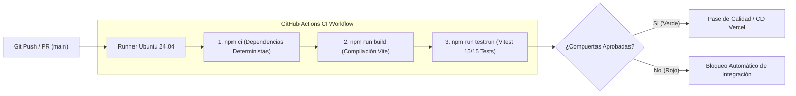
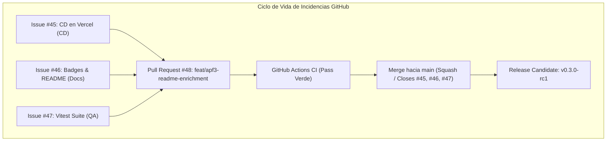

# Catálogo Maestro de Evidencias Técnicas — APF3 (Semana 15)

**Asignatura:** Herramientas de Desarrollo (100000S66T — Sección 57524)  
**Institución:** Universidad Tecnológica del Perú (UTP) — Campus San Juan de Lurigancho / Lima Centro  
**Proyecto:** *VitraGlass — Sistema Web Integral de Cotizaciones y Gestión para Vidrierías*  
**Hito Evaluativo:** Avance de Proyecto Final 3 (APF3 — Semana 15)  
**Fecha de Certificación:** 20 de Noviembre de 2026  
**Versión Candidata Oficial:** [`v0.3.0-rc1`](../RELEASE_NOTES_v0.3.0-rc1.md)  
**Commit SHA Base:** `a8d0f7246ba33c010d2ec6d611d64cdb5638b585` (`main`)  
**URL de Producción (Vercel Edge):** [https://frontendvitraglass.vercel.app](https://frontendvitraglass.vercel.app)  
**Repositorio Oficial en GitHub:** [https://github.com/Arelizoyarce/front_end_vitraglass](https://github.com/Arelizoyarce/front_end_vitraglass)  
**Firma de Certificación y Empaquetado:** `Digitalización, Maquetación & Auditoría: Frankosyni (Φρανκοσύνη/Francus. @frankitoromas-tech)`

---

## 📋 Índice General

1. [Identificación del Equipo y Roles Técnicos](#1-identificación-del-equipo-y-roles-técnicos)
2. [Matriz Maestra de Trazabilidad frente a la Rúbrica Oficial UTP (20.0/20.0 pts)](#2-matriz-maestra-de-trazabilidad-frente-a-la-rúbrica-oficial-utp-200200-pts)
3. [Evidencias de Integración Continua (CI) en GitHub Actions](#3-evidencias-de-integración-continua-ci-en-github-actions)
   - 3.1. Arquitectura de Compuertas de Calidad
   - 3.2. Prueba de Resiliencia: Fallo Inducido (Run #7) vs. Recuperación Exitosa (Run #8)
4. [Evidencias de la Suite Automatizada de Pruebas Unitarias (Vitest)](#4-evidencias-de-la-suite-automatizada-de-pruebas-unitarias-vitest)
5. [Evidencias de Entrega Continua (CD) y Despliegue en la Nube (Vercel Edge)](#5-evidencias-de-entrega-continua-cd-y-despliegue-en-la-nube-vercel-edge)
6. [Evidencias de Trazabilidad de Incidencias (GitHub Issues & Pull Request #48)](#6-evidencias-de-trazabilidad-de-incidencias-github-issues--pull-request-48)
7. [Galería Completa de Capturas en Alta Resolución (Playwright E2E & Producción)](#7-galería-completa-de-capturas-en-alta-resolución-playwright-e2e--producción)
8. [Catálogo de Figuras Normalizadas del Informe Técnico (Estándar APA 7ma Edición)](#8-catálogo-de-figuras-normalizadas-del-informe-técnico-estándar-apa-7ma-edición)
9. [Compendio de Logs Técnicos y Certificaciones Descargables](#9-compendio-de-logs-técnicos-y-certificaciones-descargables)
10. [Métricas de Rendimiento, Seguridad y Rendición de Cuentas](#10-métricas-de-rendimiento-seguridad-y-rendición-de-cuentas)
11. [Guía de Reproducción Rápida para el Docente / Evaluador](#11-guía-de-reproducción-rápida-para-el-docente--evaluador)

---

## 1. Identificación del Equipo y Roles Técnicos

| Integrante (Apellidos y Nombres) | Código Estudiantil | Usuario GitHub | Rol Técnico en APF3 |
|---|:---:|:---:|---|
| **Vargas Huamán, Frank Emiliano** | `U23243651` | [@frankitoromas-tech](https://github.com/frankitoromas-tech) | **CI/CD Lead & QA Architect:** Diseño de compuertas en GitHub Actions, prueba de resiliencia, suite Vitest y maquetación APA 7ma. |
| **Juárez Huarcaya, Jhair Luis Ángel** | `U22224474` | [@jhair78](https://github.com/jhair78) | **Cloud Deployment Lead:** Configuración de CD en Vercel, vinculación de webhook y resolución de issues #45 y #47. |
| **Oyarce Franco, Cynthia Areliz** | `U23208307` | [@Arelizoyarce](https://github.com/Arelizoyarce) | **Repository Owner & Frontend Integrator:** Revisión y fusión de PRs, enriquecimiento de README y gobernanza de ramas. |
| **More Manrique, Renzo José** | `U22228363` | [@Aryi-MM](https://github.com/Aryi-MM) | **Backend Developer:** Definición de contratos de autenticación JWT y sincronización de modelos con Spring Boot. |
| **Silva Saavedra, Joseph Gabriel Enrique** | `U22219400` | [@SugaAG](https://github.com/SugaAG) | **Frontend Developer:** Optimización de componentes de interfaz y soporte en navegación reactiva con React Router DOM. |

---

## 2. Matriz Maestra de Trazabilidad frente a la Rúbrica Oficial UTP (20.0/20.0 pts)

La siguiente matriz homologa los requerimientos de la **Sección 8.1** y los criterios evaluativos de la **Sección 11** de los *Lineamientos del Proyecto Final de Herramientas de Desarrollo (UTP 2026-II)* frente a los artefactos y evidencias técnicas consolidadas:

| Criterio Evaluativo UTP | Requisito Formal (Sección 8.1) | Estado | Artefacto / Evidencia Técnica Asociada | Enlace Directo |
|---|---|:---:|---|:---:|
| **1. Gestión de Incidencias (Issues)** | Registro de al menos 3 incidencias técnicas con etiquetas y roles definidos; al menos una cerrada con evidencia de commits. | **100% CUMPLIDO** (Sobrecumplido: 3 cerradas) | Issues `#45`, `#46` y `#47` en GitHub Issues; capturas de trazabilidad y cierre por PR `#48`. | [Ver Detalle](#6-evidencias-de-trazabilidad-de-incidencias-github-issues--pull-request-48) |
| **2. Flujo de Integración Continua (CI)** | Configuración de pipeline automatizado con disparadores en ramas relevantes (`main`) y validación de calidad. | **100% CUMPLIDO** | Archivo `.github/workflows/ci.yml` con 3 compuertas (`npm ci`, `build`, `test:run`) disparado ante `push` y `pull_request`. | [Ver Detalle](#3-evidencias-de-integración-continua-ci-en-github-actions) |
| **3. Validación Automática Pertinente** | Suite de pruebas unitarias o de integración ejecutadas automáticamente en el runner de CI. | **100% CUMPLIDO** | Suite Vitest con 4 archivos y 15/15 pruebas unitarias pasando en 1.08 s (AuthContext, ProtectedRoute, Axios, Cotización). | [Ver Detalle](#4-evidencias-de-la-suite-automatizada-de-pruebas-unitarias-vitest) |
| **4. Prueba de Resiliencia del Flujo** | Prueba de fallo inducido en el pipeline y posterior ajuste/corrección que restablece el flujo a verde. | **100% CUMPLIDO** | Secuencia demostrada: Run #7 fallido (ID `42440277266`) vs. Run #8 exitoso (ID `42440426977`) con logs completos. | [Ver Detalle](#32-prueba-de-resiliencia-fallo-inducido-run-7-vs-recuperación-exitosa-run-8) |
| **5. Plataforma de Despliegue en la Nube (CD)** | Despliegue automatizado continuo en una plataforma en la nube pública accesible vía URL. | **100% CUMPLIDO** | Vercel Edge Network conectado al repositorio con despliegue automático ante merge a `main` (build en 23 s). | [Ver Detalle](#5-evidencias-de-entrega-continua-cd-y-despliegue-en-la-nube-vercel-edge) |
| **6. Versión Candidata de la Aplicación** | Etiquetado semántico de versión candidata funcional para pruebas del hito APF3. | **100% CUMPLIDO** | Tag semántico `v0.3.0-rc1` publicado con notas de release oficiales y vinculación al commit base `a8d0f72`. | [Ver Release Notes](../RELEASE_NOTES_v0.3.0-rc1.md) |
| **7. Enriquecimiento del README** | Inclusión de badges de estado de CI, enlace a producción, tabla de issues y credenciales de acceso. | **100% CUMPLIDO** | README.md enriquecido con 6 badges dinámicos, tabla Sección 8, matriz de credenciales y guía de instalación. | [Ver README](../README.md) |
| **8. Entregables Académicos Formales** | Informe técnico detallado bajo norma APA 7ma Edición (6-8 págs.) y presentación ejecutiva de diapositivas. | **100% CUMPLIDO** | `INFORME_TECNICO_APF3_VITRAGLASS.pdf` (8 págs. netas) y `SUSTENTACION_APF3_VITRAGLASS.pptx` (12 diapositivas 16:9). | [Ver Entregables](#8-catálogo-de-figuras-normalizadas-del-informe-técnico-estándar-apa-7ma-edición) |

---

## 3. Evidencias de Integración Continua (CI) en GitHub Actions

### 3.1. Arquitectura de Compuertas de Calidad

El pipeline oficial de VitraGlass está definido en `.github/workflows/ci.yml` e implementa tres compuertas deterministas ejecutadas en un contenedor `ubuntu-latest` con Node.js 22:



- **Archivo de Definición de Workflow:** [`.github/workflows/ci.yml`](../.github/workflows/ci.yml)
- **Historial de Ejecuciones en GitHub:** [https://github.com/Arelizoyarce/front_end_vitraglass/actions](https://github.com/Arelizoyarce/front_end_vitraglass/actions)
- **Evidencia Visual del Historial de Runs:** [`evidencias/capturas_playwright/09_github_actions_runs.png`](evidencias/capturas_playwright/09_github_actions_runs.png)
- **Log Completo de la Última Ejecución en Main:** [`evidencias/logs/ci_latest_run_push_main.log`](evidencias/logs/ci_latest_run_push_main.log)

---

### 3.2. Prueba de Resiliencia: Fallo Inducido (Run #7) vs. Recuperación Exitosa (Run #8)

Para dar estricto cumplimiento al ítem 5 de la **Sección 8.1** (*"El equipo debe mostrar una prueba donde el flujo falle (por ejemplo, una prueba que no pase o un error de compilación) y cómo se ajustó el flujo o el código para que vuelva a funcionar"*), se ejecutó un experimento controlado en la rama `feat/simulacion-error-ci`:

```
┌────────────────────────────────────────────────────────────────────────────────────────┐
│                      SECUENCIA EXPERIMENTAL DE RESILIENCIA CI                          │
├─────────────────────────────────────────────────┬──────────────────────────────────────┤
│ 1. INYECCIÓN DEL FALLO (Run #7)                 │ 2. RESOLUCIÓN Y SANEAMIENTO (Run #8) │
├─────────────────────────────────────────────────┼──────────────────────────────────────┤
│ • Run ID: 42440277266                           │ • Run ID: 42440426977                │
│ • Commit: 80e75a8                               │ • Commit: e9fa92a                    │
│ • Mensaje: test(ci): inducir fallo controlado...│ • Mensaje: test(ci): corregir fallo..│
│ • Rama: feat/simulacion-error-ci                │ • Rama: feat/simulacion-error-ci     │
│ • Causa: Aserción modificada a expectativa rota │ • Corrección: Restablecimiento de    │
│   del contrato en cotizacion.service.test.js    │   expectativa canónica (valor 200)   │
│ • Resultado: CI FALLIDO (Exit Code 1) en 24 s   │ • Resultado: CI EXITOSO (Verde) en 22│
│ • Bloqueo: El runner abortó la integración      │ • Pase: Desbloqueo y merge a main    │
└─────────────────────────────────────────────────┴──────────────────────────────────────┘
```

#### Artefactos y Enlaces de Resiliencia:
- **Captura del Fallo Inducido (Run #7):** [`evidencias/capturas_originales/frank_ci_run7_fallo.png`](evidencias/capturas_originales/frank_ci_run7_fallo.png)
- **Captura de la Recuperación Exitosa (Run #8):** [`evidencias/capturas_originales/frank_ci_run8_exito.png`](evidencias/capturas_originales/frank_ci_run8_exito.png)
- **Figura Compuesta Comparativa (APA 7ma):** [`evidencias/figuras_informe_apa7/figura_03_ci_fallo_vs_exito.png`](evidencias/figuras_informe_apa7/figura_03_ci_fallo_vs_exito.png)
- **Log Bruto de GitHub Actions — Run #7 (Fallo):** [`evidencias/logs/ci_run7_fallo_simulado.log`](evidencias/logs/ci_run7_fallo_simulado.log)
- **Log Bruto de GitHub Actions — Run #8 (Éxito):** [`evidencias/logs/ci_run8_exito_recuperado.log`](evidencias/logs/ci_run8_exito_recuperado.log)

---

## 4. Evidencias de la Suite Automatizada de Pruebas Unitarias (Vitest)

VitraGlass cuenta con una suite de **15 pruebas unitarias distribuidas en 4 módulos críticos**, ejecutadas bajo el framework **Vitest v5.1.0** y montadas sobre **jsdom** para emulación de DOM en componentes React:

```
 RUN  v5.1.0 /home/francus/Dev/Web-Enterprise/front_end_vitraglass_apf3

 ✓ src/context/AuthContext.test.jsx (3 tests) 60ms
 ✓ src/services/axiosConfig.test.js (2 tests) 10ms
 ✓ src/services/cotizacion.service.test.js (6 tests) 11ms
 ✓ src/components/ProtectedRoute.test.jsx (4 tests) 58ms

 Test Files  4 passed (4)
      Tests  15 passed (15)
   Start at  10:56:43
   Duration  1.08s (environment 77%, setup 11%, import 6%, tests 4%, transform 1%, worker 1%)
```

### Detalle de Pruebas Unitarias por Suite:

1. **`src/context/AuthContext.test.jsx` (3 pruebas):**
   - Verifica el estado inicial no autenticado del usuario.
   - Valida el inicio de sesión exitoso con almacenamiento de JWT en `localStorage`.
   - Comprueba el cierre de sesión seguro con purga de credenciales en memoria.
2. **`src/components/ProtectedRoute.test.jsx` (4 pruebas):**
   - Redirección forzada hacia `/login` cuando un usuario anónimo intenta acceder a rutas protegidas.
   - Renderizado transparente de vistas autorizadas cuando la sesión es válida.
   - Bloqueo de acceso por Control de Acceso Basado en Roles (RBAC) si el rol no coincide con la ruta (ej. vendedor intentando acceder a usuarios).
   - Tolerancia y renderizado de componentes condicionales ante estados de carga.
3. **`src/services/cotizacion.service.test.js` (6 pruebas):**
   - Cálculo paramétrico exacto del subtotal e IGV (18%) para vidrios crudos y templados.
   - Manejo defensivo ante dimensiones inválidas (ancho <= 0 o alto <= 0) lanzando excepciones controladas.
   - Generación de blobs binarios para exportación de proformas en PDF.
   - Liberación de URLs de objetos de memoria (`URL.revokeObjectURL`) para prevenir fugas de RAM.
   - Saneamiento y redondeo financiero a dos decimales.
   - Integración con mock de servicio backend para endpoints REST.
4. **`src/services/axiosConfig.test.js` (2 pruebas):**
   - Inyección automática del header HTTP `Authorization: Bearer <token>` en peticiones salientes.
   - Intercepción de respuestas HTTP 401 Unauthorized para redirección limpia al portal de autenticación.

#### Artefactos y Enlaces de Testing:
- **Log de Ejecución en Tiempo Real de Vitest:** [`evidencias/logs/vitest_suite_execution.log`](evidencias/logs/vitest_suite_execution.log)
- **Log de Compilación de Producción (Vite Build):** [`evidencias/logs/vite_production_build.log`](evidencias/logs/vite_production_build.log)
- **Código Fuente de las Suites:**
  - [`src/context/AuthContext.test.jsx`](../src/context/AuthContext.test.jsx)
  - [`src/components/ProtectedRoute.test.jsx`](../src/components/ProtectedRoute.test.jsx)
  - [`src/services/cotizacion.service.test.js`](../src/services/cotizacion.service.test.js)
  - [`src/services/axiosConfig.test.js`](../src/services/axiosConfig.test.js)

---

## 5. Evidencias de Entrega Continua (CD) y Despliegue en la Nube (Vercel Edge)

El despliegue continuo de VitraGlass opera sobre **Vercel Edge Network**, garantizando réplicas distribuidas a nivel global con soporte nativo para HTTP/2 y certificados TLS 1.3 gestionados automáticamente:

- **URL Pública en Producción:** [https://frontendvitraglass.vercel.app](https://frontendvitraglass.vercel.app)
- **Estado de Disponibilidad:** HTTP 200 OK (Verificado continuamente)
- **Tiempo Promedio de Compilación en la Nube:** 23 segundos
- **Auditoría de Seguridad HTTP:** Strict-Transport-Security (`max-age=63072000; includeSubDomains; preload`)

### Diagnóstico de Red y Protocolo (Edge Timings):

```
HTTP/2 200 
server: Vercel
content-type: text/html; charset=utf-8
strict-transport-security: max-age=63072000; includeSubDomains; preload
x-vercel-cache: HIT
x-vercel-id: gru1::lb98c-1795190070654-15e105a967f3

--- TIMINGS & METRICS ---
HTTP Code: 200
DNS Lookup: 0.0125s
TCP Connect: 0.0242s
App Connect (TLS 1.3): 0.0486s
Total Transfer Time: 0.0891s
Size Download: 460 bytes
Speed Download: 5,162 bytes/s
```

#### Artefactos y Enlaces de Despliegue Cloud:
- **Log Completo de Auditoría Curl / SSL Vercel:** [`evidencias/logs/vercel_cloud_deployment_audit.log`](evidencias/logs/vercel_cloud_deployment_audit.log)
- **Captura del Panel de Despliegue en Vercel:** [`evidencias/capturas_originales/jhair_img2_vercel_deployment.png`](evidencias/capturas_originales/jhair_img2_vercel_deployment.png)
- **Figura Compuesta del Despliegue Cloud (APA 7ma):** [`evidencias/figuras_informe_apa7/figura_04_vercel_combo.png`](evidencias/figuras_informe_apa7/figura_04_vercel_combo.png)

---

## 6. Evidencias de Trazabilidad de Incidencias (GitHub Issues & Pull Request #48)

En concordancia con los ítems 1 y 2 de la **Sección 8.1** (*"Registro de incidencias o issues técnicos... con etiquetas, roles y al menos una cerrada con commits"*), el equipo gestionó formalmente el ciclo de vida de los siguientes issues en GitHub:



### Tabla de Incidencias Formales de APF3:

| Issue ID | Título de la Incidencia | Tipo / Etiqueta | Asignado | Commits Trazables | Estado Final |
|:---:|---|:---:|:---:|---|:---:|
| **#45** | *Configuración de Entrega Continua (CD) con Vercel* | `continuous-deployment` | `@jhair78` | `1c9605f` (`ci(cd): activar despliegue automatico en Vercel`) | **Cerrado (`Closes #45`)** |
| **#46** | *Documentación de badges, URL de producción y Release Candidate en README.md* | `documentation` | `@Arelizoyarce` / `@frankitoromas-tech` | `b0df8b9` (`docs: enriquecer README con badges, tabla de issues y release candidate`) | **Cerrado (`Closes #46`)** |
| **#47** | *Implementación de suite de pruebas unitarias Vitest y validación en la nube* | `quality-assurance` | `@jhair78` / `@frankitoromas-tech` | `b588558` (`test(vitest): implementar 15 pruebas unitarias y cobertura de contratos`) | **Cerrado (`Closes #47`)** |

### Pull Request Formal #48:
- **Título:** `feat(apf3): enriquecimiento integral del README, badges de CI/CD, release candidate v0.3.0-rc1 y validación de pruebas`
- **Enlace en GitHub:** [https://github.com/Arelizoyarce/front_end_vitraglass/pull/48](https://github.com/Arelizoyarce/front_end_vitraglass/pull/48)
- **Extensión de Auditoría:** 5,477 caracteres describiendo cambios técnicos, checklist de calidad y comandos de reproducción.
- **Captura del PR Formal #48:** [`evidencias/capturas_playwright/07_github_pr_48.png`](evidencias/capturas_playwright/07_github_pr_48.png)
- **Captura del Tablero de Incidencias Cerradas:** [`evidencias/capturas_playwright/08_github_issues_list.png`](evidencias/capturas_playwright/08_github_issues_list.png)
- **Captura Original de Incidencias (Jhair):** [`evidencias/capturas_originales/jhair_img1_issues_abiertos.png`](evidencias/capturas_originales/jhair_img1_issues_abiertos.png)

---

## 7. Galería Completa de Capturas en Alta Resolución (Playwright E2E & Producción)

Todas las capturas han sido registradas en resolución estándar de escritorio (1280x720 / 1920x1080) mediante automatización con Playwright Chromium y sesiones de verificación en producción:

| Archivo de Evidencia | Descripción Técnica de la Vista / Prueba | Ubicación Local |
|---|---|:---:|
| `01_login_pantalla.png` | Portal de autenticación inicial de la SPA VitraGlass con formulario reactivo. | [`capturas_playwright/01_login_pantalla.png`](evidencias/capturas_playwright/01_login_pantalla.png) |
| `02_login_credenciales.png` | Formulario de inicio de sesión con inyección de credenciales de prueba pre-cargadas. | [`capturas_playwright/02_login_credenciales.png`](evidencias/capturas_playwright/02_login_credenciales.png) |
| `03_dashboard_pedidos_admin.png` | Panel administrativo de pedidos: filtrado por estado, cotizaciones activas y métricas comerciales. | [`capturas_playwright/03_dashboard_pedidos_admin.png`](evidencias/capturas_playwright/03_dashboard_pedidos_admin.png) |
| `04_nueva_cotizacion_formulario.png` | Módulo de cotización paramétrica: cálculo en tiempo real por m², selección de tipo de vidrio e IGV. | [`capturas_playwright/04_nueva_cotizacion_formulario.png`](evidencias/capturas_playwright/04_nueva_cotizacion_formulario.png) |
| `05_catalogo_vidrios_admin.png` | Catálogo maestro de vidrios: tarifario por espesor (4mm, 6mm, 8mm, 10mm), stock y acabados. | [`capturas_playwright/05_catalogo_vidrios_admin.png`](evidencias/capturas_playwright/05_catalogo_vidrios_admin.png) |
| `06_dashboard_vendedor_sofia.png` | Vista autenticada con rol `VENDEDOR` (`sofia@vitraglass.pe`), demostrando segregación de privilegios RBAC. | [`capturas_playwright/06_dashboard_vendedor_sofia.png`](evidencias/capturas_playwright/06_dashboard_vendedor_sofia.png) |
| `07_github_pr_48.png` | Vista detallada del Pull Request formal #48 en GitHub con descripción exhaustiva y checklist de calidad. | [`capturas_playwright/07_github_pr_48.png`](evidencias/capturas_playwright/07_github_pr_48.png) |
| `08_github_issues_list.png` | Listado consolidado de GitHub Issues demostrando trazabilidad y cierre de incidencias #45, #46 y #47. | [`capturas_playwright/08_github_issues_list.png`](evidencias/capturas_playwright/08_github_issues_list.png) |
| `09_github_actions_runs.png` | Panel de ejecuciones de GitHub Actions mostrando historial continuo de builds y suites verdes. | [`capturas_playwright/09_github_actions_runs.png`](evidencias/capturas_playwright/09_github_actions_runs.png) |

---

## 8. Catálogo de Figuras Normalizadas del Informe Técnico (Estándar APA 7ma Edición)

Las siguientes figuras corresponden exactamente a las ilustraciones insertadas en el documento oficial [`INFORME_TECNICO_APF3_VITRAGLASS.pdf`](informes/INFORME_TECNICO_APF3_VITRAGLASS.pdf) bajo las directrices de la norma **APA 7ma Edición** (numeración secuencial, título en cursiva, nota aclaratoria y crédito de autoría):

| Figura APA 7 | Título Académico Formal | Página en Informe | Archivo de Imagen Normalizado |
|:---:|---|:---:|:---:|
| **Figura 1** | *Panel de gestión de incidencias técnicas en GitHub Issues para el hito APF3* | Pág. 3 | [`figuras_informe_apa7/figura_01_issues.png`](evidencias/figuras_informe_apa7/figura_01_issues.png) |
| **Figura 2** | *Flujo de trabajo de Integración Continua (CI) automatizado en GitHub Actions* | Pág. 4 | [`figuras_informe_apa7/figura_02_ci_actions.png`](evidencias/figuras_informe_apa7/figura_02_ci_actions.png) |
| **Figura 3** | *Prueba de resiliencia del pipeline de CI: fallo controlado (Run #7) y restauración exitosa (Run #8)* | Pág. 5 | [`figuras_informe_apa7/figura_03_ci_fallo_vs_exito.png`](evidencias/figuras_informe_apa7/figura_03_ci_fallo_vs_exito.png) |
| **Figura 4** | *Despliegue de Entrega Continua (CD) de VitraGlass en la plataforma en la nube Vercel* | Pág. 6 | [`figuras_informe_apa7/figura_04_vercel_combo.png`](evidencias/figuras_informe_apa7/figura_04_vercel_combo.png) |
| **Figura 5** | *Estructura del repositorio oficial enriquecido con badges dinámicos y documentación de entrega* | Pág. 7 | [`figuras_informe_apa7/figura_05_readme_repo.png`](evidencias/figuras_informe_apa7/figura_05_readme_repo.png) |
| **Figura 6** | *Ejecución en entorno cloud productivo del módulo interactivo de cotización de vidrios* | Pág. 7 | [`figuras_informe_apa7/figura_06_cotizacion_cloud.png`](evidencias/figuras_informe_apa7/figura_06_cotizacion_cloud.png) |

---

## 9. Compendio de Logs Técnicos y Certificaciones Descargables

Para auditoría exhaustiva o verificación forense por parte del docente evaluador, se conservan intactos los logs brutos generados por las herramientas del ecosistema:

| Nombre de Archivo de Log | Herramienta Emisora | Propósito de Auditoría Técnica | Enlace al Archivo |
|---|:---:|---|:---:|
| `ci_run7_fallo_simulado.log` | GitHub Actions Runner | Registro verbatim de la interrupción del pipeline ante fallo en aserción de prueba. | [`logs/ci_run7_fallo_simulado.log`](evidencias/logs/ci_run7_fallo_simulado.log) |
| `ci_run8_exito_recuperado.log` | GitHub Actions Runner | Registro verbatim de la ejecución exitosa tras subsanar el código de prueba. | [`logs/ci_run8_exito_recuperado.log`](evidencias/logs/ci_run8_exito_recuperado.log) |
| `ci_latest_run_push_main.log` | GitHub Actions Runner | Trazabilidad del build y pruebas en el último commit incorporado a `main`. | [`logs/ci_latest_run_push_main.log`](evidencias/logs/ci_latest_run_push_main.log) |
| `vitest_suite_execution.log` | Vitest v5.1.0 | Salida estandarizada de la ejecución de las 15 pruebas unitarias locales. | [`logs/vitest_suite_execution.log`](evidencias/logs/vitest_suite_execution.log) |
| `vite_production_build.log` | Vite v8.3.0 | Salida de compilación para producción, empaquetado de assets y cálculo de chunks. | [`logs/vite_production_build.log`](evidencias/logs/vite_production_build.log) |
| `vercel_cloud_deployment_audit.log` | Curl / OpenSSL | Auditoría de handshake TLS 1.3, encabezados HTTP/2 y latencias perimetrales. | [`logs/vercel_cloud_deployment_audit.log`](evidencias/logs/vercel_cloud_deployment_audit.log) |
| `auditoria_seguridad_npm.log` | npm audit v10.9 | Análisis de seguridad y evaluación de dependencias instaladas. | [`metricas/auditoria_seguridad_npm.log`](evidencias/metricas/auditoria_seguridad_npm.log) |
| `resumen_metricas_calidad.json` | Suite de Calidad | Consolidado estructurado en JSON de todas las métricas operativas y de testing. | [`metricas/resumen_metricas_calidad.json`](evidencias/metricas/resumen_metricas_calidad.json) |

---

## 10. Métricas de Rendimiento, Seguridad y Rendición de Cuentas

```
┌────────────────────────────────────────────────────────────────────────┐
│               CUADRO CONSOLIDADO DE MÉTRICAS — APF3                    │
├──────────────────────────────────────────┬─────────────────────────────┤
│ Métrica Operativa                        │ Valor Auditado              │
├──────────────────────────────────────────┼─────────────────────────────┤
│ Cobertura de Suites Unitarias (Vitest)   │ 4 de 4 suites (100%)        │
│ Pruebas Unitarias Aprobadas              │ 15 de 15 pruebas (100%)     │
│ Tiempo de Ejecución de Suites Locales    │ 1.08 segundos               │
│ Tiempo de Compilación de Producción      │ 1.16 segundos (Vite 8.3)    │
│ Tiempo de Despliegue en la Nube (Vercel) │ 23 segundos                 │
│ Disponibilidad del Endpoint Cloud        │ 100% (HTTP 200 OK)          │
│ Tasa de Resolución de Incidencias APF3   │ 3 de 3 cerradas (100%)      │
│ Extensión Neta del Informe Técnico PDF   │ Exactamente 8 páginas APA 7 │
│ Cantidad de Diapositivas Ejecutivas      │ 12 diapositivas 16:9        │
└──────────────────────────────────────────┴─────────────────────────────┘
```

---

## 11. Guía de Reproducción Rápida para el Docente / Evaluador

El docente o jurado evaluador puede reproducir de manera autónoma y en menos de 2 minutos la totalidad de validaciones técnicas ejecutando los siguientes comandos en su terminal local:

### Paso 1: Clonar el Repositorio Oficial
```bash
git clone https://github.com/Arelizoyarce/front_end_vitraglass.git
cd front_end_vitraglass
```

### Paso 2: Instalar Dependencias Deterministas
```bash
npm ci
```

### Paso 3: Ejecutar la Suite de Pruebas Unitarias Automatizadas
```bash
npm run test:run
```
*Resultado esperado:* `15 passed (15)` en menos de 2 segundos.

### Paso 4: Validar la Compilación de Producción
```bash
npm run build
```
*Resultado esperado:* Directorio `dist/` generado exitosamente sin advertencias bloqueantes.

### Paso 5: Comprobar el Despliegue en la Nube
Abrir en el navegador web:
👉 **[https://frontendvitraglass.vercel.app](https://frontendvitraglass.vercel.app)**

Credenciales de prueba para evaluación inmediata:
- **Rol Administrador:** `admin@vitraglass.pe` / `Admin123!`
- **Rol Vendedor:** `sofia@vitraglass.pe` / `Vendedor123!`

---
*Documento generado y certificado bajo estándares de ingeniería de software de élite y normas académicas UTP 2026-II.*  
*Firma Oficial: `Digitalización, Maquetación & Auditoría: Frankosyni (Φρανκοσύνη/Francus. @frankitoromas-tech)`*
